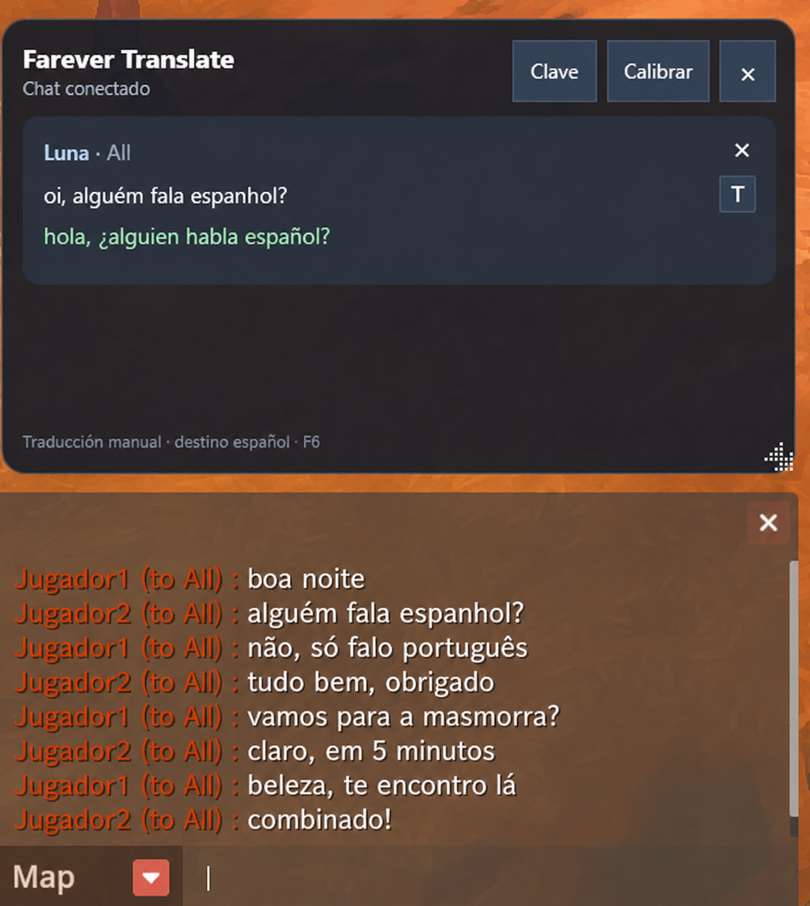

# Farever Translate

[](https://github.com/nachthelad/farever-translate/actions/workflows/ci.yml)
[](LICENSE)

Traductor manual de chat para Farever. Lee el historial del juego con acceso
de solo lectura, muestra los mensajes recientes en un panel externo y traduce
al español únicamente la línea que elegís.

> [!WARNING]
> Proyecto comunitario gratuito y no afiliado a Shiro Games. Es una
> herramienta no oficial, para uso personal y bajo responsabilidad del
> usuario. No existe garantía de aprobación o compatibilidad futura con
> Farever.



La captura usa nombres y mensajes completamente sintéticos.

## Qué hace

- Funciona de forma independiente o conserva y encadena un minimapa/DPS
  compatible ya instalado por el usuario.
- Lee Farever mediante `PROCESS_VM_READ`; no escribe memoria ni inyecta código.
- Nunca automatiza teclas, movimientos o mensajes.
- Envía a Google solamente la línea cuyo botón `T` se pulsa.
- Cifra la API key y el caché con DPAPI para el usuario actual de Windows.
- Oculta el panel fuera del mundo, al minimizar y al cambiar de aplicación.
- Deja pasar el mouse por defecto para no cortar el movimiento de cámara.

## Compatibilidad de la beta

| Componente | Versión admitida |
| --- | --- |
| Farever | Windows x64, `hlboot.dat` SHA-256 `7C3CA4DD…E7A0` |
| Farever Minimap & DPS (opcional) | v1.2.3 o v1.2.4, identificadas por SHA-256 |
| Windows | Windows 10/11 x64 |
| Pantalla | Ventana o ventana sin bordes |
| Runtime | .NET 8 Desktop Runtime x64 |

Los hashes desconocidos se rechazan. Farever está en Early Access y una
actualización puede requerir una nueva versión del traductor.

## Instalar

1. Instalá
   [.NET 8 Desktop Runtime x64](https://dotnet.microsoft.com/en-us/download/dotnet/8.0/runtime).
2. Descargá `FareverTranslate-v0.1.0-beta.1-win-x64.zip` desde
   [GitHub Releases](https://github.com/nachthelad/farever-translate/releases),
   extraelo en una carpeta aparte y no directamente sobre Farever.
3. Cerrá Farever y ejecutá `Instalar.cmd`.

El instalador busca Farever en las bibliotecas de Steam. Si no lo encuentra,
permite seleccionar la carpeta que contiene `Farever.exe`. Antes de modificar
nada verifica:

- el build de Farever;
- que un `dinput8.dll` existente sea un minimapa compatible;
- que Farever esté cerrado.

Si no existe `dinput8.dll`, el traductor se instala de forma independiente y
reenvía DirectInput al componente de Windows. Si encuentra un minimapa
compatible, lo respalda byte por byte y lo renombra como
`farever-minimap.dll` para que ambos funcionen. El proyecto no descarga ni
redistribuye el minimapa.

Si ya existe otro `dinput8.dll` desconocido, el instalador se detiene sin
moverlo, sobrescribirlo ni eliminarlo.

### Usar también el minimapa

Farever Translate es compatible con
[Farever Minimap & DPS](https://github.com/ramisotti13-eng/farever-minimap/releases)
v1.2.3 y v1.2.4. Para pasar de una instalación independiente a una combinada:

1. cerrá Farever y ejecutá `Desinstalar.cmd`;
2. instalá una versión compatible del minimapa;
3. ejecutá nuevamente `Instalar.cmd`.

### Actualizar

Descargá la nueva release, extraela en otra carpeta y ejecutá su
`Instalar.cmd`. La actualización verifica la instalación existente, prepara
los archivos nuevos, conserva el modo independiente o combinado y vuelve
automáticamente a la versión anterior si algo falla.

### Desinstalar

Cerrá Farever y ejecutá `Desinstalar.cmd` desde la carpeta extraída. Se
verifican todos los hashes antes de eliminar archivos propios. Si la
instalación usa el minimapa, se restaura el DLL original byte por byte. Si
algún archivo fue modificado, la operación se detiene para no perder datos.

## Usar

- `F6`: mostrar u ocultar el panel mientras Farever está en primer plano.
- `Alt` sola: habilitar botones, scroll, arrastre y resize.
- `Alt` nuevamente: devolver inmediatamente el mouse al juego.
- `T`: traducir esa línea al español.
- `×`: descartar una línea que no interesa.
- **Calibrar**: mover o redimensionar el panel.
- **Clave**: guardar o borrar la API key de Google Cloud Translation.

Las combinaciones `Alt+Tab`, `Alt+F4`, `Alt+Enter`, `Alt+Shift` y `AltGr` no
alternan la interacción del traductor.

## Configurar Google Cloud

Cada usuario aporta su propia API key:

1. Crear o seleccionar un proyecto en Google Cloud.
2. Activar **Cloud Translation API**.
3. Crear una API key restringida únicamente a esa API.
4. Configurar una cuota y alertas de presupuesto.
5. Abrir **Clave** en el panel y pegarla.

Google puede modificar precios, créditos y cuotas. Consultá la
[documentación de configuración](docs/GOOGLE_CLOUD.md) y la
[tabla oficial de precios](https://cloud.google.com/translate/pricing).

## Privacidad y seguridad

- Los mensajes y credenciales nunca se escriben en logs.
- La API key y el caché se guardan bajo
  `%LOCALAPPDATA%\FareverTranslate`, cifrados para el usuario actual.
- No hay telemetría ni servidor propio.
- Los binarios de esta beta no están firmados. Cada release publica
  `SHA256SUMS.txt` para verificar la descarga.
- La MIT cubre solamente el código de este repositorio. Farever, sus marcas y
  el minimapa pertenecen a sus respectivos titulares.

Consultá los [límites técnicos](docs/SECURITY.md) y la
[política de seguridad](SECURITY.md).

## Solución de problemas

- **Falta .NET 8 Desktop Runtime x64:** instalá el Desktop Runtime, no solo el
  runtime de consola.
- **No se encontró Farever:** seleccioná la carpeta que contiene
  `Farever.exe`.
- **Ya existe un `dinput8.dll` desconocido:** puede pertenecer a otro mod.
  El instalador no lo sobrescribe. Retirá ese mod siguiendo sus propias
  instrucciones antes de instalar el traductor.
- **Minimapa no compatible:** si querés usar ambos, reinstalá una versión
  indicada en la tabla; no renombres otro mod como `dinput8.dll`.
- **Versión de Farever no compatible:** no fuerces la instalación. Adjuntá el
  hash mostrado en un Issue.
- **El panel no aparece:** entrá al mundo con un personaje y pulsá `F6`.
- **El mouse no responde al panel:** pulsá y soltá `Alt` sola.

No publiques API keys, texto del chat ni archivos de caché al pedir ayuda.

## Compilar y probar

Requisitos de desarrollo:

- .NET 8 SDK;
- Visual Studio Build Tools 2022 con C++ x64;
- PowerShell 7 recomendado.

```powershell
.\scripts\Test-All.ps1
.\scripts\Build-Package.ps1
```

El ZIP y su checksum quedan en `artifacts\release`.

## Licencia y atribución

Farever Translate se publica bajo [MIT](LICENSE).

“Farever” y sus marcas pertenecen a Shiro Games. Este proyecto no contiene
archivos del juego ni código, DLL, imágenes o datos del proyecto
Farever Minimap & DPS.
